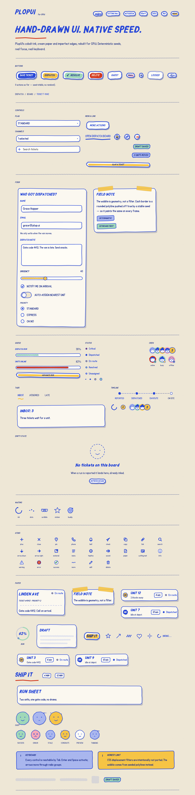
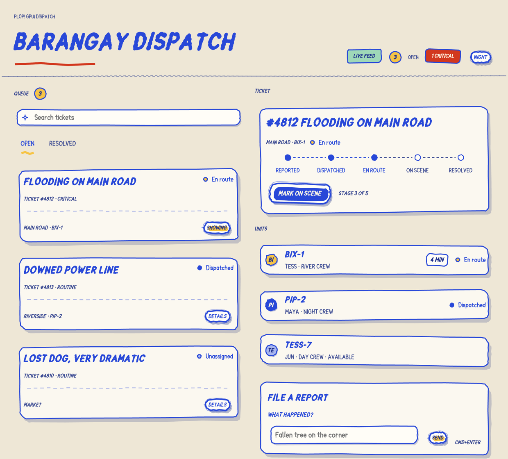
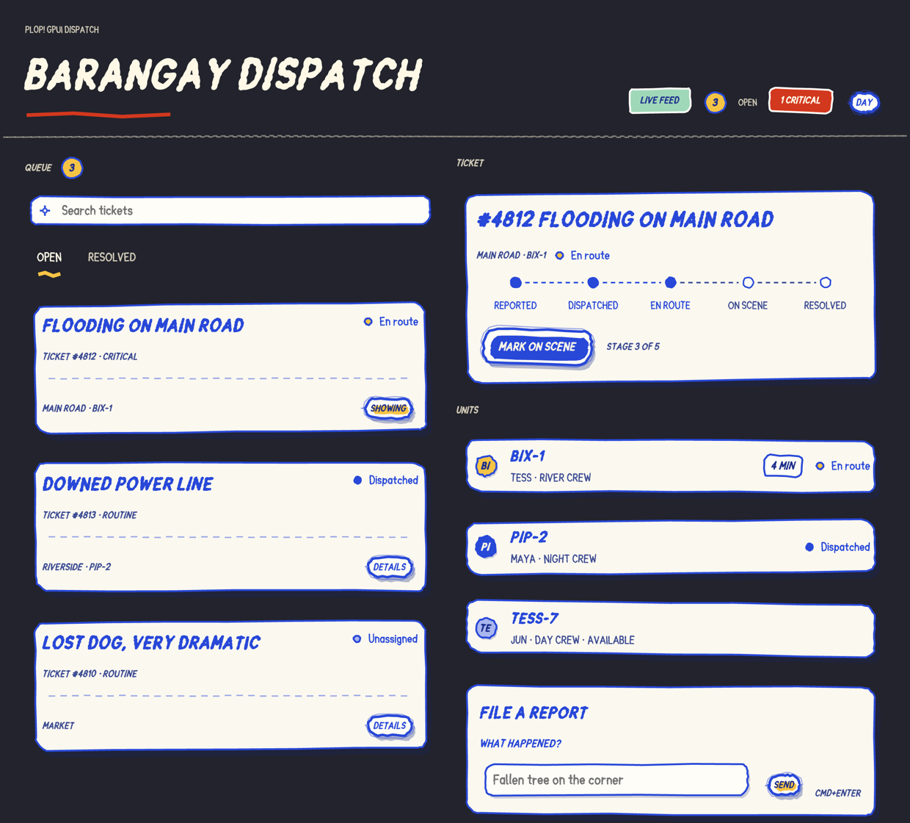

# gpui-plop-ui

**[English](README.md) | [简体中文](README.zh-CN.md)**

Hand-drawn UI components for [GPUI](https://gpui.rs) — a Rust port of the PlopUI React kit.

**Author:** DeepSeek

Cobalt ink, cream paper, and an outline that never sits quite straight. Every tilt, wobble and hatch offset comes from a seeded generator, so a frame repaints identically at 60 fps. No `random()` runs during render.



51 components, real focus, real keyboard, a live toast queue, seeded ink bursts on every press, and a full dispatch console built as a second example.

---

## Quick start

```sh
cargo run -p plopui-gpui --example gallery     # 1240×920 component gallery
cargo run -p plopui-gpui --example dispatch    # ticket queue app
cargo run -p plopui-gpui --example capture     # render the gallery to PNG, no window
```

The gallery window is 1240×920. The surface switcher in the top right changes the paper; the **NIGHT** tag toggles light and dark. Start on a given surface directly:

```sh
PLOP_SURFACE=notebook PLOP_DARK=1 cargo run -p plopui-gpui --example gallery
```

`PLOP_SURFACE` accepts `poster` (default), `mat`, `notebook`, `kraft` and `riso`.

### Capture a PNG without a window

```sh
PLOP_CAPTURE_HEIGHT=5050 cargo run -p plopui-gpui --example capture
```

Renders off-screen through the headless Metal path and writes `/tmp/plopui-gallery.png` (2480×10100 at 2× for the full sheet). It needs no visible window and no unlocked desktop session — a locked macOS login screen is fine.

| Variable | Default | What it does |
| --- | --- | --- |
| `PLOP_CAPTURE_OUT` | `/tmp/plopui-gallery.png` | Output path |
| `PLOP_CAPTURE_HEIGHT` | `920` | Window height in logical pixels; raise it to capture the whole page |
| `PLOP_SURFACE` / `PLOP_DARK` | `poster` / off | Same as the gallery |

> **Build in release for the window examples.** `gpui-pre` carries debug-only accessibility assertions; a debug build of `gallery` or `dispatch` can panic on a duplicate a11y node or a double `set_focus` before the first frame is presented. Release builds discard those assertions, and shrink the binaries from ~65–82 MB to ~15–20 MB.
>
> ```sh
> cargo run --release -p plopui-gpui --example gallery
> ```

---

## The dispatch app

`examples/dispatch.rs` is the React `apps/dispatch-demo` rebuilt as a native app: a ticket queue with search, the five-stage timeline, unit cards, a report form, and the live toast queue. The gallery proves each component in isolation; this one proves they compose.



```sh
cargo run --release -p plopui-gpui --example dispatch
PLOP_CAPTURE_OUT=/tmp/dispatch.png cargo run -p plopui-gpui --example dispatch
PLOP_DARK=1 PLOP_SURFACE=notebook PLOP_CAPTURE_OUT=/tmp/dispatch-dark.png \
  cargo run -p plopui-gpui --example dispatch
PLOP_DISPATCH_QUERY=zzz PLOP_CAPTURE_OUT=/tmp/dispatch-empty.png \
  cargo run -p plopui-gpui --example dispatch
```

The window is 1240×1120 with a 1024×860 minimum. Type in **Search tickets** to filter by kind, place or assigned unit; the empty state distinguishes "quiet queue" from "search found nothing", and its button either clears the search or switches tabs. **/** jumps to the search from anywhere outside a text field, and **Escape** empties it. Pick a ticket with **DETAILS**, then advance it with the stage button; the last step holds the loading button for 900 ms before the toast arrives. **SEND** files a report and selects it, and **⌘Enter** / **Ctrl+Enter** does the same from anywhere in the window.



---

## Components

### Actions

| Component | Notes |
| --- | --- |
| `PlopButton` | Die-cut sticker; `fill`, `disabled`, `small`, `icon_only`, `flat`, `icon`, `loading` / `loading_label`, `on_click` |
| `PlopButtonLink` | Link semantics: Enter activates, Space does not; hand-drawn underline |
| `PlopIconButton` | Square sticker for a glyph or one of the 25 `IconKind`s, with a separate accessible label |
| `PlopMenu` | Trigger plus focusable items; Enter runs an item and closes the menu |
| `PlopTooltip` / `plop_tooltip` | Native GPUI tooltip containing a paper card |
| `PlopCommandPalette` | Absolute overlay with query input; Up/Down/Enter/Escape captured |

### Inputs

| Component | Notes |
| --- | --- |
| `PlopCheckbox` | `gpui-base` checkbox behind the hand-drawn box; Space toggles |
| `PlopSwitch` | `gpui-base` switch behind the hand-drawn track; Space flips |
| `PlopRadio` | `gpui-base` radio behind the hand-drawn ring |
| `PlopRadioGroup` | Legend, one roving tab stop; arrows and Home/End move selection and focus, Space activates |
| `PlopTextField` | `gpui-base` input: IME, selection, clipboard and undo stay native |
| `PlopTextArea` | Multi-line `gpui-base` state on a hand-drawn sheet |
| `PlopSlider` | `gpui-base` slider state; arrows, Home/End and pointer drag share one value |
| `PlopSelect` | Combobox: Space/Enter/Down opens, arrows move, Escape closes |
| `PlopMultiSelect` | Open panel with one focus handle per option; Space toggles |
| `PlopSearchField` | `gpui-base` input with a magnifier on a painted field |

### Navigation

| Component | Notes |
| --- | --- |
| `PlopTabs` | Roving focus: arrows move and select, Home/End jump, Enter/Space reselect |
| `PlopBreadcrumb` | Ink trail with the current page at full strength |
| `PlopTabPanel` | Shows its children when the matching tab is selected |

### Display

| Component | Notes |
| --- | --- |
| `PlopTag` | Display-only torn-paper tag |
| `PlopCard` | Cream sheet with optional tape and title; establishes the paper text scope |
| `PlopSheet` | Large paper sheet for a page-level block |
| `PlopStickyNote` | Taped note with title, body or children |
| `PlopTicketCard` | Ticket stub with code, status and a perforation line |
| `PlopUnitCard` | Dispatch unit row: avatar, name, detail, ETA and status |
| `PlopUnitCardRow` | Vertical stack of unit cards |
| `PlopStatusDot` | Small status dot with size and label |
| `PlopStatus` | One of the five token statuses |
| `PlopAvatar` | Doodle face generated from the name, optional online/busy/offline dot; `.initials()` for team marks |
| `PlopAvatarStack` | Overlapping faces plus a `PlopCount` overflow chip |
| `PlopCount` | Round unread counter with an ink outline |
| `PlopEmptyState` | Dashed doodle, one sentence and one action |
| `PlopProgress` | Hand-drawn track and fill, optional label and value |
| `PlopProgressRing` | Seeded ring with percentage and optional caption |
| `PlopSkeleton` | Seeded placeholder bars |
| `PlopSkeletonText` | Multi-line skeleton with seeded line widths |
| `PlopLoader` | Spinner plus a waiting sentence |
| `PlopEta` | Small time estimate on a tag |
| `PlopDivider` | Wobbly rule |

### Feedback

| Component | Notes |
| --- | --- |
| `PlopCallout` | Info / warn / error / success |
| `PlopToast` | Compact message card |
| `PlopToaster` | Display-only stack of toasts, newest last |
| `ToastQueue` / `show_toast` / `PlopToastHost` | One live toast at a time: entity queue with auto-dismiss, app-wide helpers, observing host view |
| `PlopStatusTimeline` | Labelled steps; completed dots are ink, upcoming dots are outlined |
| `PlopSpinner` | Five marks: ink, dots, scribble, sticker and buddy; reduced motion leaves them at rest |
| `PlopInkBurstHost` / `install_ink_bursts` | Press feedback: sticker buttons throw a short, seeded ink burst at the click |

### Characters

| Component | Notes |
| --- | --- |
| `PlopBuddy` | Six moods drawn as faces: success, error, stale, congrats, preview, thinking |
| `PlopBuddyPeek` | A buddy cropped at the bottom, peeking over an edge |
| `BUDDY_CAST` | Pip, Bix, Snooze, Confetti, Specs and Hum with their moods |

### Icons and lettering

| Component | Notes |
| --- | --- |
| `PlopIcon` / `IconKind` | 25 marker icons: the everyday set, the surface marks and the four status stickers. Path data is sampled by `plopui_core::svg` |
| `PlopHeading` | Marker lettering with underline |
| `PlopLettering` | Free-standing marker text with an optional underline |
| `PlopWordSticker` | One word inside a die-cut sticker |
| `PlopDoodle` | Star, arrow, squiggle, heart or sparkle, drawn from a seed |

### Theming

`PlopTheme` is both a GPUI global and a value: call `PlopTheme::init(cx)` once, read `PlopTheme::current(cx)` anywhere, and `PlopTheme::set(cx, theme)` when the app changes surface. Components still take their own `PlopTheme`, so a section can preview another surface without disturbing the app. Text on cream paper stays ink: `PlopTheme::on_paper()` keeps the surface but returns the light variant — that is what tickets and unit cards use for their status pills.

The font is Sketchpop, loaded from `assets/fonts` by the examples. A host application must load those fonts before rendering; `gallery::load_fonts(cx)` shows the `include_bytes!` calls.

---

## Architecture

```
crates/
  plopui-core   pure Rust, no GPUI dependency
                tokens · seeded randomness · WCAG contrast · motion · hand-drawn geometry
  plopui-gpui   the component layer
                tokens → GPUI colors · canvas painting · gpui-base wrappers
```

- **Painting, not CSS.** GPUI has no SVG filter pipeline, so borders are rounded polylines pushed off true by a stable seed, and hatching is painted line by line.
- **Behaviour is borrowed, not rebuilt.** `gpui-base` already carries focus tracking, Tab order, Space/Enter activation, IME, selection, clipboard and undo. The port supplies the visual layer only — the same split the React kit makes with native elements.
- **Deterministic frames.** Every tilt, border wobble and hatch offset comes from `plopui_core::seed`, which reproduces the TypeScript implementation exactly (UTF-16 FNV-1a plus mulberry32). The tests compare against the JavaScript output, not a Rust-only snapshot.
- **Text on paper uses ink tokens,** never the surface `on` colour. The React kit gets this from `.plop-paper`; the port scopes the same rule inside cards, fields, checkboxes and tabs.

---

## Keyboard and accessibility

Activation keys are split deliberately. GPUI turns Space and Enter into a synthetic click on any element with an `on_click` handler, so a link that also handled Enter would fire twice and a combobox would open on key-down then close on key-up. `PlopButtonLink`, `PlopSelect` and `PlopMultiSelect` therefore activate from the pointer through `on_mouse_up` and handle keys explicitly.

Every interactive component is focusable and reachable by Tab, and every rule below is enforced by a test rather than eyeballed:

| Component | Keys |
| --- | --- |
| Checkbox / Switch | Space toggles |
| Tabs | Arrows move and select, Home/End jump, Enter/Space reselect |
| Slider | Arrows step, Home/End jump |
| RadioGroup | Arrows and Home/End move selection and focus, one tab stop |
| TextField / TextArea | Full `gpui-base` IME stack |
| Select | Space/Enter/Down opens, arrows move, Escape closes |
| MultiSelect | Space toggles an option |
| Menu | Enter runs an item |
| ButtonLink | Enter only, never Space |
| Loading button | Swallows Space and Enter until it settles |

Accessible names are always text, never colour alone — status dots, avatars and counters all carry a label.

---

## Tests

```sh
cargo test -p plopui-gpui     # components + headless paint/keyboard tests
cargo test --workspace        # includes the token and seed vectors
```

24 test cases today:

- **`tests/headless.rs`** — renders a sticker off-screen and asserts real cobalt pixels were painted, drives Space and Enter through `gpui-base` and checks the click handler fired, renders a generated face and checks the ink outline and status dot reach the image, renders the live toast host, draws an 18 px spinner inside an absolute overlay, and checks an ink burst leaves warm marks.
- **`tests/controls.rs`** — Space on checkbox and switch, arrows/Home/End on tabs and slider, the focus move that comes with tab selection, typing through `PlopTextArea`, Space/Enter/Down + Escape on `PlopSelect`, Space on a `PlopMultiSelect` option, Enter on a `PlopMenu` item, Enter-only activation on a link, toast replacement and dismissal, arrows/Home/End on a radio group, a loading button that ignores Space and Enter, pointer and keyboard ink bursts, the `PlopTheme` global round-trip, and `on_paper()` keeping ink text ink on dark pages.

Test coverage is the honest weak spot of this port: the React kit ships 212 cases across 21 files, this crate ships 24. The interaction primitives are covered; per-component state coverage is not yet at parity.

---

## Known limits

- **Debug builds can trip `gpui-pre`'s accessibility assertions.** The a11y layer `debug_assert!`s on duplicate node ids and on more than one `set_focus` per frame; a debug `gallery`/`dispatch` may panic before the first frame. Release builds discard those assertions. Screenshot capture is unaffected — the headless path builds no a11y tree.
- **macOS only, verified.** The renderer is `gpui-kit`'s headless Metal path. Linux and Windows are untested.
- **CSS displacement filters are intentionally not ported.** The wobble is geometry, which is what keeps it deterministic.
- **No squash, no haptics.** A sticker bursts on press but does not squash; a desktop has no phone buzz.
- **Still missing from the React kit:** `NumberStepper` and `Pagination` (both added upstream after this port branched), plus `AvatarSymbol` and `SpinnerMark`. `PlopFilters` is intentionally absent — CSS displacement filters are replaced by seeded geometry.
- **Pinned versions.** `gpui-kit = 0.9.0`, `gpui-pre = 0.3.11`, Rust 1.99.1. Bump all three together and re-run `cargo test --workspace` plus a fresh capture.

---

## Credits and license

- **gpui-plop-ui** is written and maintained by **DeepSeek**.
- It is a port of **PlopUI**, the React hand-drawn UI kit by the PlopUI project (`Snorlark/plop-ui`). The design language, component inventory and interaction rules originate there.
- [GPUI](https://gpui.rs) provides the renderer and application model; `gpui-base` provides the interaction primitives.
- Sketchpop ships under the SIL Open Font License (see `assets/fonts/OFL.txt`).
- GPUI itself is Apache-2.0; the PlopUI tokens and code are MIT.
