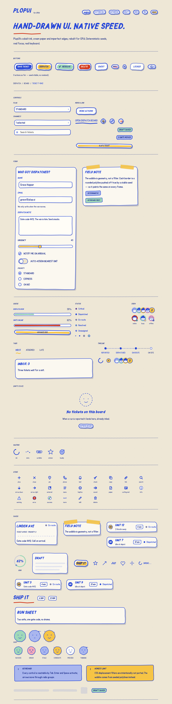
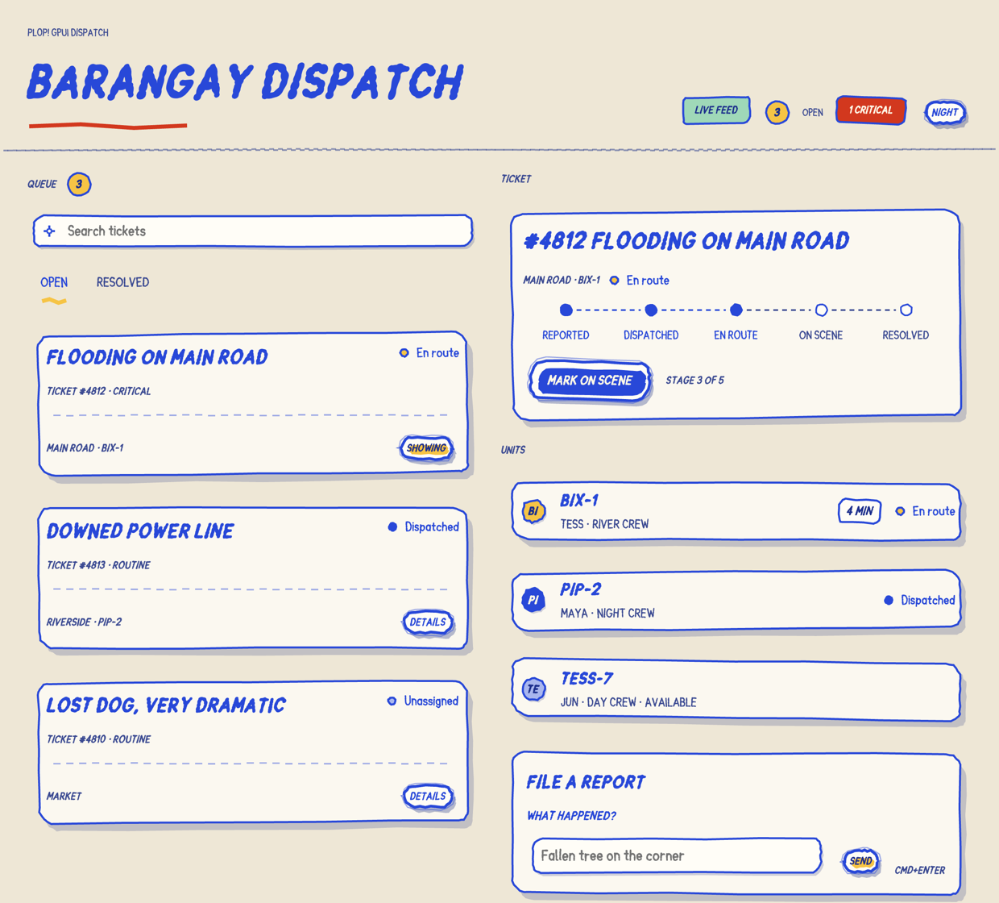
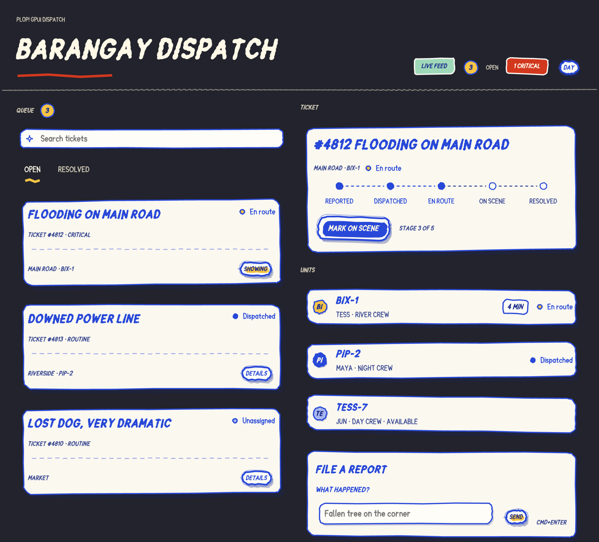

# gpui-plop-ui

**[English](README.md) | [简体中文](README.zh-CN.md)**

面向 [GPUI](https://gpui.rs) 的手绘风格 UI 组件库 —— PlopUI React 组件包的 Rust 移植版。

**作者：** DeepSeek

钴蓝墨迹、奶油纸面，以及那条永远不会完全笔直的轮廓线。每一处倾斜、抖动和排线偏移都来自种子生成器，因此同一帧在任何时候重绘都完全一致，60 fps 下不打颤。渲染过程中不调用任何 `random()`。



51 个组件，真实的焦点系统、真实的键盘交互、实时 toast 队列、每次按下都会溅出的种子墨迹，以及一个完整的调度台示例应用。

---

## 快速开始

```sh
cargo run -p plopui-gpui --example gallery     # 1240×920 组件画廊
cargo run -p plopui-gpui --example dispatch    # 工单队列应用
cargo run -p plopui-gpui --example capture     # 把画廊渲染成 PNG，不开窗口
```

画廊窗口为 1240×920。右上角的纸面切换器可以换纸张，**NIGHT** 标签切换明暗。也可以直接指定纸面启动：

```sh
PLOP_SURFACE=notebook PLOP_DARK=1 cargo run -p plopui-gpui --example gallery
```

`PLOP_SURFACE` 可选 `poster`（默认）、`mat`、`notebook`、`kraft`、`riso`。

### 不开窗口直接出图

```sh
PLOP_CAPTURE_HEIGHT=5050 cargo run -p plopui-gpui --example capture
```

走无头的 Metal 渲染路径离屏绘制，输出 `/tmp/plopui-gallery.png`（整页 2 倍图，2480×10100）。不需要可见窗口，也不需要解锁桌面会话 —— macOS 停在登录界面时同样可以跑。

| 环境变量 | 默认值 | 作用 |
| --- | --- | --- |
| `PLOP_CAPTURE_OUT` | `/tmp/plopui-gallery.png` | 输出路径 |
| `PLOP_CAPTURE_HEIGHT` | `920` | 窗口逻辑高度，调大即可截整页 |
| `PLOP_SURFACE` / `PLOP_DARK` | `poster` / 关 | 与画廊一致 |

> **窗口类示例请用 release 构建。** `gpui-pre` 里带有一套只在 debug 生效的无障碍断言；debug 版的 `gallery` 或 `dispatch` 可能在首帧呈现前就因重复的 a11y 节点、或一帧内多次 `set_focus` 而 panic。release 构建会丢弃这些断言，同时把二进制从约 65–82 MB 缩到约 15–20 MB。
>
> ```sh
> cargo run --release -p plopui-gpui --example gallery
> ```

---

## 调度台示例

`examples/dispatch.rs` 把 React 版的 `apps/dispatch-demo` 重建成了原生应用：带搜索的工单队列、五阶段时间线、单位卡片、上报表单，以及实时 toast 队列。画廊证明每个组件单独可用，这个示例证明它们能组合起来用。



```sh
cargo run --release -p plopui-gpui --example dispatch
PLOP_CAPTURE_OUT=/tmp/dispatch.png cargo run -p plopui-gpui --example dispatch
PLOP_DARK=1 PLOP_SURFACE=notebook PLOP_CAPTURE_OUT=/tmp/dispatch-dark.png \
  cargo run -p plopui-gpui --example dispatch
PLOP_DISPATCH_QUERY=zzz PLOP_CAPTURE_OUT=/tmp/dispatch-empty.png \
  cargo run -p plopui-gpui --example dispatch
```

窗口 1240×1120，最小尺寸 1024×860。在 **Search tickets** 里输入可按类型、地点或所属单位过滤；空状态会区分「队列本来就空」和「搜索没结果」，它的那个按钮会相应地清空搜索或切换标签页。**/** 可以从任意非输入框位置跳到搜索框，**Escape** 清空它。用 **DETAILS** 选中工单，再用阶段按钮推进；最后一步会让加载按钮保持 900 ms，然后弹出 toast。**SEND** 提交上报并自动选中它，**⌘Enter** / **Ctrl+Enter** 在窗口任意位置等效。



---

## 组件

### 操作类

| 组件 | 说明 |
| --- | --- |
| `PlopButton` | 模切贴纸按钮；`fill`、`disabled`、`small`、`icon_only`、`flat`、`icon`、`loading` / `loading_label`、`on_click` |
| `PlopButtonLink` | 链接语义：Enter 激活，Space 不激活；带手绘下划线 |
| `PlopIconButton` | 方形贴纸按钮，放字形或 25 个 `IconKind` 之一，无障碍标签单独提供 |
| `PlopMenu` | 触发器加可聚焦菜单项；Enter 执行并关闭 |
| `PlopTooltip` / `plop_tooltip` | GPUI 原生 tooltip，内容是纸面卡片 |
| `PlopCommandPalette` | 绝对定位浮层，含查询输入；接管 Up/Down/Enter/Escape |

### 输入类

| 组件 | 说明 |
| --- | --- |
| `PlopCheckbox` | 手绘方框背后是 `gpui-base` 的复选框；Space 切换 |
| `PlopSwitch` | 手绘轨道背后是 `gpui-base` 的开关；Space 翻转 |
| `PlopRadio` | 手绘圆环背后是 `gpui-base` 的单选 |
| `PlopRadioGroup` | 带图例，单一 tab 停靠点；方向键和 Home/End 同时移动选中项与焦点，Space 激活 |
| `PlopTextField` | `gpui-base` 输入框：IME、选区、剪贴板、撤销全部保持原生 |
| `PlopTextArea` | 手绘纸面上的多行 `gpui-base` 状态 |
| `PlopSlider` | `gpui-base` 滑块状态；方向键、Home/End 与指针拖拽共用一个值 |
| `PlopSelect` | 组合框：Space/Enter/Down 打开，方向键移动，Escape 关闭 |
| `PlopMultiSelect` | 展开面板，每个选项一个焦点句柄；Space 切换选中 |
| `PlopSearchField` | `gpui-base` 输入框，绘制纸面上带放大镜 |

### 导航类

| 组件 | 说明 |
| --- | --- |
| `PlopTabs` | 漫游焦点：方向键移动并选中，Home/End 跳到首尾，Enter/Space 重新选中 |
| `PlopBreadcrumb` | 墨迹面包屑，当前页用全强度 |
| `PlopTabPanel` | 对应标签页被选中时显示其子节点 |

### 展示类

| 组件 | 说明 |
| --- | --- |
| `PlopTag` | 仅展示的撕纸标签 |
| `PlopCard` | 奶油色纸卡，可选胶带和标题；建立纸面文字作用域 |
| `PlopSheet` | 用于页面级区块的大纸张 |
| `PlopStickyNote` | 贴胶带的便签，可放标题、正文或子节点 |
| `PlopTicketCard` | 票根卡片，带编号、状态和骑缝线 |
| `PlopUnitCard` | 调度单位行：头像、名称、详情、ETA 和状态 |
| `PlopUnitCardRow` | 单位卡片的纵向堆叠 |
| `PlopStatusDot` | 小状态圆点，可设尺寸和标签 |
| `PlopStatus` | 五种 token 状态之一 |
| `PlopAvatar` | 按名字生成涂鸦表情，可加在线/忙碌/离线圆点；`.initials()` 改为首字母标记 |
| `PlopAvatarStack` | 相互叠压的头像，溢出部分用 `PlopCount` 角标 |
| `PlopCount` | 圆形未读数角标，带墨线描边 |
| `PlopEmptyState` | 虚线涂鸦、一句话和一个操作 |
| `PlopProgress` | 手绘进度条，可选标签和数值 |
| `PlopProgressRing` | 种子生成的环形进度，带百分比和可选说明 |
| `PlopSkeleton` | 种子生成的占位条 |
| `PlopSkeletonText` | 多行骨架，行宽由种子决定 |
| `PlopLoader` | 转圈加一句等待文案 |
| `PlopEta` | 贴在小标签上的时间预估 |
| `PlopDivider` | 手绘波浪分隔线 |

### 反馈类

| 组件 | 说明 |
| --- | --- |
| `PlopCallout` | info / warn / error / success |
| `PlopToast` | 紧凑消息卡片 |
| `PlopToaster` | 仅展示的 toast 堆叠，新的在后 |
| `ToastQueue` / `show_toast` / `PlopToastHost` | 同一时刻一条实时 toast：带自动消失的实体队列、全局辅助函数、观察队列的宿主视图 |
| `PlopStatusTimeline` | 带标签的步骤；已完成的点是墨色，未到的是空心 |
| `PlopSpinner` | 五种样式：墨迹、圆点、涂鸦、贴纸和伙伴；开启减少动态时停在静止帧 |
| `PlopInkBurstHost` / `install_ink_bursts` | 按压反馈：贴纸按钮被点击时溅出一小片种子墨迹 |

### 角色

| 组件 | 说明 |
| --- | --- |
| `PlopBuddy` | 六种情绪，画成表情：success、error、stale、congrats、preview、thinking |
| `PlopBuddyPeek` | 底部被裁掉、从边缘探头的小家伙 |
| `BUDDY_CAST` | Pip、Bix、Snooze、Confetti、Specs、Hum 及各自情绪 |

### 图标与字体排版

| 组件 | 说明 |
| --- | --- |
| `PlopIcon` / `IconKind` | 25 个马克笔图标：日常图标集、纸面标记和四个状态贴纸。路径数据由 `plopui_core::svg` 采样 |
| `PlopHeading` | 带下划线的马克笔标题 |
| `PlopLettering` | 独立马克笔文字，可选下划线 |
| `PlopWordSticker` | 一个词装在模切贴纸里 |
| `PlopDoodle` | 星星、箭头、波浪、爱心或闪光，由种子绘制 |

### 主题

`PlopTheme` 既是 GPUI 全局量也是普通值：在应用启动时调用一次 `PlopTheme::init(cx)`，任意位置用 `PlopTheme::current(cx)` 读取，切换纸面时用 `PlopTheme::set(cx, theme)`。组件仍然各自接收自己的 `PlopTheme`，所以页面上某个区块可以预览另一种纸面而不影响全局。纸面上的文字始终是墨色：`PlopTheme::on_paper()` 保留纸面但返回浅色变体 —— 票根卡片和单位卡片的状态药丸用的就是它。

字体是 Sketchpop，由示例从 `assets/fonts` 加载。宿主应用必须在渲染前加载这些字体；`gallery::load_fonts(cx)` 里有 `include_bytes!` 的写法。

---

## 架构

```
crates/
  plopui-core   纯 Rust，不依赖 GPUI
                token · 种子随机 · WCAG 对比度 · 动效偏好 · 手绘几何
  plopui-gpui   组件层
                token → GPUI 颜色 · canvas 绘制 · gpui-base 包装
```

- **画出来，而不是靠 CSS。** GPUI 没有 SVG 滤镜管线，所以边框是由稳定种子推离真实位置的圆角折线，排线是一根根画出来的。
- **借行为，不重造。** `gpui-base` 已经带了焦点跟踪、Tab 顺序、Space/Enter 激活、IME、选区、剪贴板和撤销。这个移植只提供视觉层 —— 和 React 版本对待原生元素的分工完全一样。
- **帧是确定的。** 每一处倾斜、边框抖动和排线偏移都来自 `plopui_core::seed`，它精确复刻了 TypeScript 实现（UTF-16 FNV-1a 加 mulberry32）。测试比对的是 JavaScript 的输出，而不是 Rust 自己的快照。
- **纸面上的文字用墨色 token，** 而不是纸面的 `on` 颜色。React 版靠 `.plop-paper` 作用域实现，这个移植把同样的规则收进了卡片、输入框、复选框和标签页内部。

---

## 键盘与无障碍

激活键是刻意分开处理的。GPUI 会把 Space 和 Enter 变成带 `on_click` 元素的合成点击，所以如果链接同时处理 Enter 就会触发两次，组合框则会在 key-down 打开又在 key-up 立刻关闭。因此 `PlopButtonLink`、`PlopSelect` 和 `PlopMultiSelect` 的指针激活走 `on_mouse_up`，按键则显式处理。

每个可交互组件都可聚焦、都能用 Tab 到达，下面每一条规则都由测试保证，而不是靠肉眼看：

| 组件 | 按键 |
| --- | --- |
| Checkbox / Switch | Space 切换 |
| Tabs | 方向键移动并选中，Home/End 跳首尾，Enter/Space 重新选中 |
| Slider | 方向键步进，Home/End 跳首尾 |
| RadioGroup | 方向键和 Home/End 同时移动选中与焦点，单一 tab 停靠点 |
| TextField / TextArea | 完整 `gpui-base` IME 栈 |
| Select | Space/Enter/Down 打开，方向键移动，Escape 关闭 |
| MultiSelect | Space 切换选项 |
| Menu | Enter 执行菜单项 |
| ButtonLink | 只响应 Enter，绝不响应 Space |
| 加载中的按钮 | 在状态落定前吞掉 Space 和 Enter |

可访问名称永远是文字，从不只靠颜色 —— 状态点、头像和计数器都带标签。

---

## 测试

```sh
cargo test -p plopui-gpui     # 组件测试 + 无头绘制/键盘测试
cargo test --workspace        # 含 token 与种子向量
```

目前 24 个用例：

- **`tests/headless.rs`** —— 离屏渲染一个贴纸按钮并断言真的画出了钴蓝像素；通过 `gpui-base` 驱动 Space 和 Enter 并检查点击回调触发；渲染生成的涂鸦头像并检查墨线轮廓和状态点进入了图像；渲染实时 toast 宿主；在绝对定位浮层里画一个 18 px 的转圈并检查它确实被画出；检查墨迹溅射留下了暖色痕迹。
- **`tests/controls.rs`** —— 复选框和开关的 Space、标签页与滑块的方向键/Home/End、选中标签页时带来的焦点移动、`PlopTextArea` 输入、`PlopSelect` 的 Space/Enter/Down + Escape、`PlopMultiSelect` 选项的 Space、`PlopMenu` 项的 Enter、链接只响应 Enter 的激活、toast 替换与关闭、单选组的方向键/Home/End、忽略 Space 和 Enter 的加载按钮、指针与键盘两种墨迹溅射、`PlopTheme` 全局量往返，以及 `on_paper()` 让深色纸面上的墨色文字保持墨色。

测试覆盖是这个移植最诚实的短板：React 版有 21 个文件、212 个用例，这个 crate 只有 24 个。交互原语是覆盖到的，但逐个组件的状态覆盖还没到同等水平。

---

## 已知限制

- **debug 构建可能触发 `gpui-pre` 的无障碍断言。** 它的 a11y 层对重复节点 id 和「一帧内多次 `set_focus`」有 `debug_assert!`，所以 debug 版的 `gallery`/`dispatch` 有可能在首帧之前就 panic。release 构建会丢弃这些断言。截图不受影响 —— 无头路径根本不构建 a11y 树。
- **只在 macOS 上验证过。** 渲染走的是 `gpui-kit` 的无头 Metal 路径，Linux 和 Windows 未测试。
- **CSS 位移滤镜是刻意不移植的。** 抖动来自几何，这正是它能保持确定性的原因。
- **没有压扁效果，也没有触感反馈。** 贴纸按钮按下会溅墨，但不会压扁；桌面上也没有手机震动。
- **React 版里仍缺：** `NumberStepper` 和 `Pagination`（都是这个移植分支拉出之后上游才加的），以及 `AvatarSymbol` 和 `SpinnerMark`。`PlopFilters` 是刻意缺失的 —— CSS 位移滤镜由种子几何替代。
- **版本锁死。** `gpui-kit = 0.9.0`、`gpui-pre = 0.3.11`、Rust 1.99.1。三个要一起升，升完重跑 `cargo test --workspace` 并重新截一次图。

---

## 致谢与许可

- **gpui-plop-ui** 由 **DeepSeek** 编写与维护。
- 它是 **PlopUI** 的移植 —— 那套 React 手绘 UI 组件库，来自 PlopUI 项目（`Snorlark/plop-ui`）。设计语言、组件清单和交互规则都源自那里。
- [GPUI](https://gpui.rs) 提供渲染器与应用模型，`gpui-base` 提供交互原语。
- Sketchpop 字体以 SIL Open Font License 发布（见 `assets/fonts/OFL.txt`）。
- GPUI 本身是 Apache-2.0；PlopUI 的 token 与代码是 MIT。
